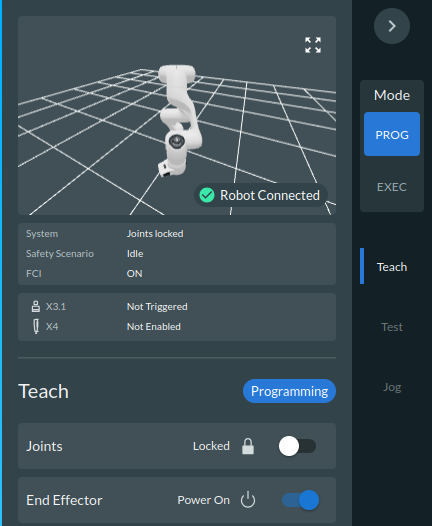
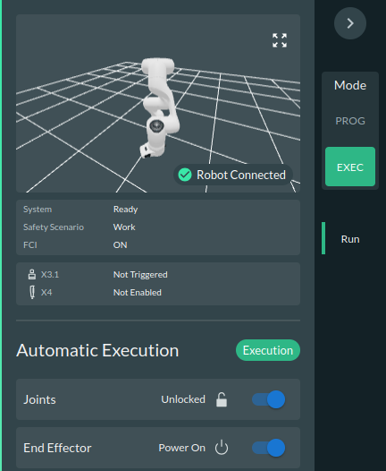

# Franka Research 3 — Start-Up & ROS 2 Control Guide

**Hardware start-up · Franka Desk · ROS 2 Jazzy · friction calibration · joint/Cartesian control · UDP integration**

> **Audience:** Operators using a Franka Research 3 (FR3) with the [`Franka-Research-3-ROS2-Control-Under-Constraints`](https://github.com/fleurssauvages/Franka-Research-3-ROS2-Control-Under-Constraints/) stack.  
> **Scope:** A practical operating sequence, not a replacement for the applicable Franka operating manual, risk assessment, or the repository's installation README.  
> **Software:** ROS 2 Jazzy; packages `low_level`, `franka_cartesian_control`, and `udp_bridge`.

---

## At a glance

| Stage | Operator action | Expected result |
|:--|:--|:--|
| **1. Hardware** | Power the control box; release the emergency stop; connect both Ethernet links. | Robot powers up and network connections are available. |
| **2. Franka Desk** | Enter Programming, unlock joints, set pose, switch to Execution, activate FCI. | Robot is ready to accept ROS control. |
| **3. ROS workspace** | Open Terminator; source ROS and the built workspace. | All three custom packages are discoverable. |
| **4. Calibration** | In a clear workspace, optionally run friction identification for impedance mode. | Recent calibration YAML is available. |
| **5. Control** | Launch **one** low-level or high-level control stack. | Controller becomes ready; commands can be issued. |
| **6. Test & monitor** | Publish a conservative twist/pose, or route commands through UDP; inspect PlotJuggler. | Motion and feedback match expectations. |
| **7. Shutdown** | Stop command sources; stop the controller; return the robot to a safe state. | No ROS motion controller remains active. |

> [!CAUTION]
> **Real robot = real motion.** Keep the reachable space clear, confirm the robot is firmly mounted, verify the tool/payload in Desk, and keep the emergency-stop function accessible. Publish only commands that have been checked against the actual workspace. Software command timeouts, QP constraints, and a UDP stop packet are **not** substitutes for the robot's safety functions.

### Contents

1. [Hardware start-up](#1-hardware-start-up)
2. [Franka Desk](#2-franka-desk)
3. [Starting ROS 2](#3-starting-ros-2)
4. [Friction calibration](#4-friction-calibration)
5. [Low-level control](#5-low-level-control)
6. [Cartesian velocity and force control](#6-cartesian-velocity-control)
7. [Cartesian position control](#7-cartesian-position-control)
8. [Gripper control](#8-gripper-control)
9. [Using the external UDP module](#9-using-the-external-udp-module)
10. [Visualizing data with PlotJuggler](#10-visualizing-data-with-plotjuggler)
11. [Stopping, troubleshooting, and reference](#11-stopping-troubleshooting-and-reference)

---

## 1. Hardware start-up

### 1.1 Power on

1. Check that the robot arm is properly mounted and its entire reachable workspace is unobstructed.
2. **Turn on the robot control box.**
3. **Release/raise the emergency-stop button** according to the installed button mechanism. Do not bypass any safety device.
4. Wait approximately **30 seconds** while the robot initializes. The LEDs at the base of the arm typically blink during startup and then settle into a steady indication.

For this operating setup, the relevant base LED indications are:

| LED color | Interpretation | Operator response |
|:--|:--|:--|
| **Blue** | Programming mode | Use Franka Desk for setup / guided manipulation. |
| **Green** | Execution mode | External motion control may be possible once all other requirements are satisfied. |
| **Red** | Error/fault, e.g. emergency stop still engaged | Resolve the fault in Desk and check the safety system before continuing. |

The exact LED behavior may vary with the installed Franka System Image. Use the status shown in **Franka Desk** to confirm the robot's actual state; LED color alone does not establish control readiness.

### 1.2 Connect the two Ethernet cables

This setup uses **two distinct network connections**:

| Connection | Physical endpoint | Purpose |
|:--|:--|:--|
| **Desk network** | Ethernet connection at the **robot base** | Access the Franka Desk web interface. |
| **FCI/control network** | Ethernet connection at the **control box** | Low-level communication between the robot and the ROS computer using the Franka Control Interface (FCI). |

Make sure the control computer's interfaces and IP configuration match the specific lab network. If two network adapters are used, verify the route to each address; the Desk and FCI endpoints must not be confused.

> [!IMPORTANT]
> **IP addresses in the supplied instructions differ.** The locally bookmarked **Desk** address is `192.168.0.1`, whereas the repository's **ROS launch default** for `robot_ip` is `192.16.0.1`. These are *not* the same address. Confirm the actual address of **each endpoint** on your installation before connecting; do **not** assume one is a typo or automatically reuse the Desk URL for FCI.

Useful networking checks on the control PC:

```bash
# Show interfaces and assigned IP addresses.
ip -brief address

# Verify the Desk endpoint from the interface connected to the robot base.
ping -c 2 192.168.0.1

# Verify FCI reachability IF this is really your installed FCI address.
ping -c 2 192.16.0.1
```

A successful ping alone does not prove that Desk, FCI, or the safety system is ready.

**Before moving on:** control box powered, emergency stop released, correct network links connected, no unresolved robot fault.

---

## 2. Franka Desk

Franka Desk is the robot's web-based configuration and operating interface.

### 2.1 Open the interface

1. Open a web browser on the computer connected to the Desk network.
2. Enter the **actual Desk IP address**. In this setup, `http://192.168.0.1` is saved in the browser's favorites bar.
3. Check the robot connection/status information. Resolve any active safety fault before proceeding.
4. Check that the configured **end effector, tool and payload** match the physical hardware. A wrong payload can cause unexpected gravity-related behavior.

### 2.2 Programming mode: unlock and position the arm

1. In the **right-hand panel**, select **PROG** (Programming mode).
2. In **Teach**, switch **Joints** from **Locked** to **Unlocked**.
3. Wait for the audible unlocking **clicks at all joints** before attempting to guide the arm.
4. To reposition the FR3 manually, use the **two enabling buttons at the end effector** as required by the installed hand-guiding interface; on this setup, one is a **half-switch**. Keep the enabling controls in the required state while guiding, and use gentle, deliberate movements.
5. Position the arm near the region in which you intend to operate, checking full-arm and end-effector clearance.

**Desk screenshot — Programming mode.** The screenshot shows the blue **PROG** selection and the joints still **locked**; unlock them before manually guiding the robot.



### 2.3 Execution mode: prepare for ROS control

1. After manual positioning, release the guiding controls and make sure the arm is stationary.
2. Switch the right-hand panel to **EXEC** (Execution mode).
3. Check that the required system and safety statuses are ready, and confirm the joints are unlocked as required for execution.
4. At the **top section** of Desk, select the **robot name** and choose **Activate FCI** (wording/location may vary across System Images).
5. Verify that Desk reports **FCI: ON** before starting ROS controllers.

**Desk screenshot — Execution mode.** The green **EXEC** selection is active; the screenshot shows **System: Ready**, **Joints: Unlocked**, and **FCI: ON**.



> [!NOTE]
> **Programming and Execution serve different purposes.** Use Programming for appropriate hand-guided setup; switch to Execution and activate FCI before running the ROS motion-control stack. The Desk *End Effector Power* toggle is not the same thing as a ROS gripper command.

**Before moving on:** correct payload/tool, arm placed safely, **Execution mode**, joints ready, **FCI ON**.

---

## 3. Starting ROS 2

### 3.1 Open the workspace

Open **Terminator** (recommended for splitting panes) or a regular terminal. The examples below use `~/user_ws`; replace this path with your real workspace if necessary.

```bash
cd ~/user_ws
source /opt/ros/jazzy/setup.bash # Loaded by default in the bashsrc you don't have to necessarily
source install/setup.bash
```

If your Franka drivers were installed in a **separate** workspace, source that required underlay *before* sourcing `~/user_ws/install/setup.bash`, for example:

```bash
source /opt/ros/jazzy/setup.bash
source ~/franka_ws/install/setup.bash  # only if this is your driver workspace, also loaded by default in the bashsrc
source ~/user_ws/install/setup.bash
```

Source the appropriate overlays in **every new terminal**. Avoid mixing old and newly built overlays.

### 3.2 First-time setup (skip if already installed)

This repository expects **ROS 2 Jazzy**, a working `franka_ros2`/FCI setup, and the dependencies documented in its [README](https://github.com/fleurssauvages/Franka-Research-3-ROS2-Control-Under-Constraints/#readme) and `INSTALL.md`. In particular, **QP and LMPC require qpOASES**; real robot control benefits from a real-time-capable Linux configuration.

If you do not yet have a custom workspace:

```bash
mkdir -p ~/user_ws/src
cd ~/user_ws/src

git clone \
  https://github.com/fleurssauvages/Franka-Research-3-ROS2-Control-Under-Constraints.git \
  fr3_control_stack

cd ~/user_ws
source /opt/ros/jazzy/setup.bash
# Source the installed Franka driver underlay here if required.

# Check that colcon discovers the intended packages.
colcon list | grep -E 'low_level|franka_cartesian_control|udp_bridge'
```

Install the Franka ROS 2 dependencies and qpOASES **as described in the repository** before building. Then:

```bash
cd ~/user_ws
rosdep install --from-paths src --ignore-src -y

# For an already configured workspace:
colcon build --symlink-install

# If qpOASES lives in a workspace-local prefix, the repository documents
# passing -DQPOASES_ROOT=/absolute/path/to/qpoases_install as a CMake arg.
source install/setup.bash
```

Check the installation:

```bash
ros2 pkg prefix low_level
ros2 pkg prefix franka_cartesian_control
ros2 pkg prefix udp_bridge
```

If the packages are not found, review the workspace layout and overlay source order. **Do not run hardware commands until the build succeeds and the network/FCI configuration is validated.**

### 3.3 Organize Terminator

Split Terminator into as many panes as needed. A useful arrangement is:

| Pane | Use |
|:--|:--|
| **A — controller** | Launch one control stack and watch startup logs. |
| **B — command source** | Publish test ROS commands, or run the UDP bridge. |
| **C — feedback** | Inspect readiness, joint states, topics, and controller state. |
| **D — visualization** | PlotJuggler, when needed. |

High-level Cartesian launches normally start the **low-level controller internally** (`start_low_level:=true`). Therefore, **do not launch a second independent low-level stack at the same time**. To attach a Cartesian controller to an already running low-level stack, explicitly use `start_low_level:=false` and verify compatibility.

### 3.4 How the controllers fit together

```text
Desired Cartesian pose: /fr3/cartesian_pose_command (PoseStamped)
                              |
                              v
                     PID or LMPC (50 Hz)
                              |
                    desired Cartesian twist
                              |
                              v
                   IK or constrained QP (200 Hz)
                              |
                    desired joint commands
                              |
                              v
                 Velocity or impedance (1 kHz)
                              |
                              v
                       Franka Research 3
```

For **direct Cartesian velocity control**, skip the PID/LMPC layer:

```text
TwistStamped -> IK or QP -> low-level control -> FR3
```

For **Cartesian wrench control**:

```text
WrenchStamped -> ik_force (J(q)^T F) -> /fr3/tau_command -> low-level torque -> FR3
```

The repository uses `robot_ip:=192.16.0.1` by default. When that does **not** match your robot's verified **FCI IP**, append `robot_ip:=<actual_FCI_IP>` to the relevant launch command.

---

## 4. Friction calibration

### 4.1 When to calibrate

If you intend to use **low-level impedance control with friction compensation**, run the residual-friction identification before your session, especially if the existing calibration is stale. The default age limit is **24 hours**, so recalibrating roughly **once per day** is a good operating habit.

This friction model is **not used by the low-level velocity controller**. It is also **different from Franka's native joint-torque-sensor calibration** in Desk: the latter is a separate maintenance/calibration procedure and should be carried out when indicated by Franka's procedure, not automatically every day.

### 4.2 Prepare the robot

1. In Programming mode, hand-guide the arm to the configuration around which you intend to work.
2. Switch back to Execution and activate FCI as described in [Section 2](#2-franka-desk).
3. Ensure ample clearance around **every joint and link**, not just the TCP. The calibration automatically moves **one joint at a time** in positive/negative sweeps around the initial configuration.
4. Remove unintended external contact and check tool/payload settings. Remain ready to stop the test.

> [!WARNING]
> `run_motion:=true` causes **physical robot motion**. Do not use the calibration command with a person or obstacle in the reachable workspace. The run time depends on the configured sweeps and may be **around 10 minutes**, but is not fixed.

### 4.3 Run the identification

For a read-only/data-path check, with no commanded calibration motion:

```bash
ros2 launch low_level dynamics_identification.launch.py \
  run_motion:=false
```

For the actual friction calibration:

```bash
ros2 launch low_level dynamics_identification.launch.py \
  motion_mode:=joint \
  run_motion:=true
```

Set gripper loading consistently with the installed hardware and the experiment's intended robot description; consult the launch options before changing the configuration.

The output is stored in the workspace calibration directory, typically:

```text
<workspace>/data/calibration/
  friction_identification_YYYYMMDD_HHMMSS.csv
  friction_identification_YYYYMMDD_HHMMSS.json
  friction_calibration_YYYYMMDD_HHMMSS.yaml
```

### 4.4 Verify/use the result

A later impedance launch automatically attempts to load the newest **valid, sufficiently recent** calibration (default maximum age: 24 h). If no acceptable file exists, the impedance controller can start but **friction feedforward remains disabled**.

For a first supervised test with a newly validated calibration, use a reduced compensation scale instead of assuming the full default `1.0` is appropriate:

```bash
ros2 launch low_level control.launch.py \
  mode:=impedance \
  friction_compensation_scale:=0.3
```

Check the effective controller state after launch:

```bash
ros2 param get /low_level_joint_impedance_controller friction_compensation_enabled
ros2 param get /low_level_joint_impedance_controller friction_calibration_valid
ros2 param get /low_level_joint_impedance_controller friction_calibration_source
```

Friction compensation remains active on **measured** motion even if the incoming joint command times out. A watchdog is **not** an emergency stop; deactivate the controller to stop active assistance. Experimental `breakaway_enabled` and `gravity_error_compensation_enabled` should remain **false** during routine use unless they have been validated specifically for your setup.

---

## 5. Low-level control

Run **one** of the following controllers when you want direct joint-level control without a Cartesian layer.

### 5.1 Impedance mode

```bash
ros2 launch low_level control.launch.py mode:=impedance
```

**What to expect:** Franka's existing baseline gravity compensation is supplemented by the stack's configured impedance/effort terms; with the reference's low default stiffness/damping, the arm may be movable by hand under the applicable safety conditions. The behavior depends on the **effective running controller parameters**; do not assume that every launch is freely backdrivable. A fresh, valid friction calibration can enable residual-friction compensation.

The impedance controller accepts `sensor_msgs/msg/JointState` on `/fr3/joint_commands`; complete seven-joint `position`, `velocity`, or `effort` command fields can be used according to the configured gains.

### 5.2 Velocity mode

```bash
ros2 launch low_level control.launch.py mode:=velocity
```

**What to expect:** The controller actively tracks commanded joint velocities. Without a valid fresh command, it trends toward zero commanded velocity under its watchdog/tracker behavior; the arm is **not intended for free hand-guiding** in this mode. Do not push against the robot to test rigidity.

The low-level command interface is:

```text
Topic: /fr3/joint_commands
Type:  sensor_msgs/msg/JointState
Rate: low-level hardware loop 1 kHz; commands can arrive at a lower rate
```

The reference velocity controller defaults to a **0.1 s command timeout** and limits accelerations/jerk; this is not a safety-rated stop.

### 5.3 External joint torque mode

The new `mode:=torque` uses the same low-level impedance controller but **replaces the stiffness/damping tracking contribution with externally commanded joint torque**. The rest of the configured compensation pipeline is retained: validated friction feedforward, optional breakaway assistance, and optional pose-local gravity-error bias compensation. The controller does not add nominal model gravity a second time; Franka's effort interface already handles baseline gravity compensation.

```bash
ros2 launch low_level control.launch.py mode:=torque
```

**Input topic:** `/fr3/tau_command` (`sensor_msgs/msg/JointState`, seven `effort` values in FR3 joint order). No desired positions or velocities are required.

For a first connection check, publish **zero external torque** at 50 Hz in a clear workspace:

```bash
ros2 topic pub -r 50 /fr3/tau_command sensor_msgs/msg/JointState \
  "{name: [fr3_joint1, fr3_joint2, fr3_joint3, fr3_joint4, fr3_joint5, fr3_joint6, fr3_joint7], effort: [0.0, 0.0, 0.0, 0.0, 0.0, 0.0, 0.0]}"
```

Zero *external* torque does not necessarily imply zero actuator effort: enabled friction and local-bias compensation may still produce torques. A calibration file must satisfy the same validity and freshness checks as impedance mode. Verify `friction_calibration_valid`, the effective compensation settings, and the controller's torque/rate limits before nonzero tests. The command watchdog is not an emergency stop; some assistance terms can continue after the command expires.

### 5.4 Confirm successful startup

A change in motor sound can be a useful practical indication that the hardware controller has activated, but **motor noise alone is not confirmation**. Watch the launch logs and check:

```bash
ros2 control list_controllers
ros2 topic echo --once /franka/joint_states

# Use the readiness topic corresponding to the active low-level mode:
ros2 topic echo --once /low_level_joint_impedance_controller/ready
# or:
ros2 topic echo --once /low_level_joint_velocity_controller/ready
```

When `enable_gripper:=true` (the low-level launch default), the launch also starts the **gripper control node**.

**To stop:** terminate any command publisher first, then press **Ctrl+C** in the low-level launch terminal and verify the controller has stopped.

---

## 6. Cartesian velocity control

Use Cartesian velocity control to command a TCP translation/rotation rate. The high-level launch **normally brings up the low-level layer automatically**.

### 6.1 QP controller (constraint-aware)

```bash
ros2 launch franka_cartesian_control cartesian_control.launch.py \
  controller:=qp
```

The quadratic-programming (**QP**) controller tracks the Cartesian twist while applying configured limits and constraints, including joint position/velocity/acceleration margins and configured workspace surfaces (such as the table). The repository also provides self-collision constraints and recovery behavior.

QP constraints are valuable safeguards, but **they do not certify collision-free behavior**: the actual table plane, TCP, obstacles, end effector, and safety margins must be configured correctly. In particular, the example table half-space uses `z >= 0.08 m` in the controller's root frame; that is meaningful only when it corresponds to the physical installation.

### 6.2 IK controller (kinematic baseline)

```bash
ros2 launch franka_cartesian_control cartesian_control.launch.py \
  controller:=ik
```

The inverse-kinematics (**IK**) controller converts desired Cartesian twist into joint velocities using damped pseudoinverse kinematics plus its configured recovery behavior. It does **not** offer the same general hard constraint formulation as the QP.

### 6.3 Choose the underlying hardware mode

The Cartesian velocity launch defaults to **low-level velocity**. To use impedance (for example, when you need the calibrated friction feedforward):

```bash
ros2 launch franka_cartesian_control cartesian_control.launch.py \
  controller:=qp \
  low_level_mode:=impedance
```

Or explicitly choose velocity:

```bash
ros2 launch franka_cartesian_control cartesian_control.launch.py \
  controller:=qp \
  low_level_mode:=velocity
```

For an initial impedance run, consider explicitly setting the high-level forwarding argument `impedance_friction_compensation_scale:=0.3`, after verifying it exists in your installed launch file with `--show-args`.

### 6.4 Cartesian force controller (`ik_force`)

`ik_force` maps a Cartesian wrench to seven joint torques using the current KDL Jacobian: **`tau_ext = J(q)^T F_desired`**. Its output is `/fr3/tau_command`, which is handled by the low-level `torque` mode. With the Cartesian launch's automatic low-level selection, `controller:=ik_force` selects that mode without a separate low-level launch.

```bash
ros2 launch franka_cartesian_control cartesian_control.launch.py \
  controller:=ik_force
```

**Input topic:** `/fr3/cartesian_wrench_command` (`geometry_msgs/msg/WrenchStamped`). Force is in newtons and moment in newton-metres, expressed in the configured KDL root frame (normally `fr3_link0`). The node does not transform arbitrary `frame_id` values with TF.

Start with a **zero-wrench communications test**:

```bash
ros2 topic pub -r 50 /fr3/cartesian_wrench_command \
  geometry_msgs/msg/WrenchStamped \
  "{header: {frame_id: 'fr3_link0'},
    wrench: {force: {x: 0.0, y: 0.0, z: 0.0},
             torque: {x: 0.0, y: 0.0, z: 0.0}}}"
```

Check readiness and the generated torques in separate sourced terminals:

```bash
ros2 topic echo --once /ik_force_controller/ready
ros2 topic echo /fr3/tau_command
ros2 control list_controllers
```

Only after confirming the end-effector frame, model readiness, limits, compensation configuration, and workspace clearance should a trained operator test a **small nonzero force**. For example, changing `force.z` to `2.0` requests 2 N along root-frame +Z; it **does not** regulate measured contact force and may move the robot. The optional `force_input_mode:=twist` uses damped differential IK and velocity-error feedback to form a wrench before the Jacobian-transpose torque mapping; it is not equivalent to the conventional IK velocity controller.

### 6.5 Publish a desired Cartesian twist

**Input topic:** `/fr3/cartesian_twist_command`  
**ROS type:** `geometry_msgs/msg/TwistStamped`

The example below publishes a **zero twist** at 20 Hz. It is a first communication test and should not request movement:

```bash
ros2 topic pub -r 20 \
  /fr3/cartesian_twist_command \
  geometry_msgs/msg/TwistStamped \
  "{header: {frame_id: 'fr3_link0'},
    twist: {
      linear:  {x: 0.0, y: 0.0, z: 0.0},
      angular: {x: 0.0, y: 0.0, z: 0.0}
    }}"
```

After validating the command frame, controller readiness, safety setup, and space, you can test a **very small nonzero component**, e.g. `linear.x: 0.005` m/s for a short, supervised interval. **Stop publishing to end the test.**

> [!IMPORTANT]
> The numeric twist components are interpreted in the controller's **root-frame convention**, normally `fr3_link0`. These nodes do **not** transform the message based on `header.frame_id`; write values already expressed in the required frame.

Check the active controller:

```bash
ros2 topic echo --once /qp_velocity_controller/ready
# If running IK instead:
ros2 topic echo --once /ik_velocity_controller/ready
ros2 topic info -v /fr3/cartesian_twist_command
```

**To stop:** stop the twist publisher first, then **Ctrl+C** the Cartesian launch.

---

## 7. Cartesian position control

Cartesian position control adds a **pose-to-twist** controller above the Cartesian velocity layer.

### 7.1 Launch a PID position controller

Example: **PID → IK → low-level impedance**:

```bash
ros2 launch franka_cartesian_control position_control.launch.py \
  position_controller:=pid \
  velocity_controller:=ik \
  low_level_mode:=impedance
```

Alternative: **PID → QP → low-level velocity**:

```bash
ros2 launch franka_cartesian_control position_control.launch.py \
  position_controller:=pid \
  velocity_controller:=qp \
  low_level_mode:=velocity
```

### 7.2 Launch an LMPC position controller

To use linear model-predictive control instead of PID:

```bash
ros2 launch franka_cartesian_control position_control.launch.py \
  position_controller:=lmpc \
  velocity_controller:=qp \
  low_level_mode:=impedance
```

Available layer choices:

| Layer | Choices | Responsibility |
|:--|:--|:--|
| **Position** | `pid`, `lmpc` | Converts a target TCP pose into a Cartesian twist. |
| **Cartesian velocity** | `ik`, `qp` | Converts desired TCP twist into joint commands. |
| **Low-level hardware** | `velocity`, `impedance`, `torque` | Drives the seven robot joints; `torque` accepts external effort. |

QP and LMPC depend on qpOASES. Use `ros2 launch franka_cartesian_control position_control.launch.py --show-args` to verify which options your checkout accepts.

### 7.3 Check the current pose *before* commanding a target

```bash
ros2 topic echo --once /fr3/cartesian_pose
```

Use the reported `position` and `orientation` as the starting point, then change them conservatively. The input topic is:

```text
Topic: /fr3/cartesian_pose_command
Type:  geometry_msgs/msg/PoseStamped
Frame: controller root frame (usually fr3_link0)
```

The repository's default **pose-command watchdog** is **0.50 s**, so publish continuously to maintain a target.

### 7.4 Publish a desired Cartesian pose

The following is the **illustrative pose from the supplied procedure**. **Do not paste it onto a live robot without first verifying that it is nearby, reachable, correctly oriented, and safe for the current configuration.** Prefer replacing all position/orientation values with the measured pose and only a small intended change.

```bash
ros2 topic pub -r 20 \
  /fr3/cartesian_pose_command \
  geometry_msgs/msg/PoseStamped \
  "{header: {frame_id: 'fr3_link0'},
    pose: {
      position:    {x: 0.4, y: -0.2, z: 0.3},
      orientation: {x: 1.0, y: 0.0, z: 0.0, w: 0.0}
    }}"
```

The orientation fields form a quaternion (`x`, `y`, `z`, `w`), **not Euler angles**. Use a normalized quaternion. The controller does not apply a TF conversion when it receives a pose in another frame: supply coordinates expressed in its expected root frame.

**To stop:** stop the pose publisher, then press **Ctrl+C** in the position-control launch. Confirm hardware/controller shutdown before starting a different stack.

---

## 8. Gripper control

Gripper actuation is **disabled by default** in all low-level and Cartesian control launch files. To enable it, set `enable_gripper:=true` when launching the controller.

When enabled, the launch automatically starts the official Franka Hand driver and the project's `gripper_control_node`.

**Example — Enable gripper control:**

```bash
ros2 launch franka_cartesian_control cartesian_control.launch.py \
    controller:=qp \
    enable_gripper:=true
```

The gripper is controlled through the following ROS 2 topic:

```text
Topic: /fr3/gripper
Type:  std_msgs/msg/Float32
Range: 0.0 to 1.0
```

- `0.0` = fully closed (0 m requested width).
- `1.0` = fully open (normally approximately 0.08 m).

**Open the gripper:**

```bash
ros2 topic pub --once /fr3/gripper std_msgs/msg/Float32 '{data: 1.0}'
```

**Close the gripper:**

```bash
ros2 topic pub --once /fr3/gripper std_msgs/msg/Float32 '{data: 0.0}'
```

The default closing behavior may use the Franka **Grasp** action, while opening uses the **Move** action. Ensure the fingers and surrounding workspace are clear before commanding movement.

### End-effector configuration

Gripper actuation is independent of Cartesian kinematics. All Cartesian controllers automatically obtain the end-effector transformation (`F_T_EE`) from Franka Desk through the live robot state, regardless of the `enable_gripper` setting.

**Important:** `enable_gripper:=true` is intended for the official Franka Hand. Custom or third-party grippers configured in Desk require their own ROS drivers. Configuring an end effector in Desk does not automatically enable ROS gripper actuation.

---

## 9. Using the external UDP module

The repository includes a **generic, JSON-configured UDP ↔ ROS 2 bridge** in the `udp_bridge` package. It is intended for exchanging commands/telemetry with an **external device, script, workstation, or control program** without writing a new ROS node for each message type.

### 9.1 Data flow

```text
External program                                  Franka ROS 2 computer
----------------                                  -------------------
UDP command packet  --------------------------->  udp_bridge reader
                                                   |
                                                   v
                                       /fr3/cartesian_twist_command
                                                   |
                                                   v
                                           QP/IK -> low level -> FR3

External receiver  <---------------------------  udp_bridge publisher
                                                   ^
                                                   |
                                             /franka/joint_states
```

There are **two independently configurable directions**:

| Bridge direction | JSON file | Typical role |
|:--|:--|:--|
| **UDP → ROS 2** | `udp_reader.json` | Read an externally produced Cartesian twist and publish it as a ROS message. |
| **ROS 2 → UDP** | `udp_publisher.json` | Read robot joint-state feedback and forward it to an external program. |

Store the active configuration outside the package, for example:

```text
~/user_ws/data/udp/
  udp_reader.json
  udp_publisher.json
```

> [!NOTE]
> The JSON keys and endpoint structure are defined by the repository's supplied configuration files. **Copy/edit those templates** rather than inventing a new schema. The bridge supports binary or JSON payloads, ROS topic/type selection, field mappings, QoS, optional source filtering, and optional header timestamps.

### 9.2 Receive Cartesian twist from an external program

The README's **binary reader example** expects six **little-endian float64** values on UDP port **15000**, in this order:

| Item | Position | ROS destination field |
|:--|:--|:--|
| `vx` | 1 | `twist.linear.x` |
| `vy` | 2 | `twist.linear.y` |
| `vz` | 3 | `twist.linear.z` |
| `wx` | 4 | `twist.angular.x` |
| `wy` | 5 | `twist.angular.y` |
| `wz` | 6 | `twist.angular.z` |

All six values together take **48 bytes** (`6 × 8`). For example, the template's field mapping includes:

```json
{"name": "vx", "type": "float64", "ros_field": "twist.linear.x"}
```

The UDP reader publishes a `geometry_msgs/msg/TwistStamped` to `/fr3/cartesian_twist_command`. Set the JSON's receiving `bind_ip` and `bind_port` to the **network interface and port actually reachable by the external sender**. If appropriate, configure a sender `source_ip`/`source_port` filter. Ensure the message defaults assign the correct root-frame convention (`fr3_link0`) and/or automatic timestamp behavior where required.

**External-side zero-motion connectivity test (Python 3).** Replace the address with the **ROS PC's UDP-reader IP**, *not* the Desk or FCI address, and confirm the port from your JSON:

```python
import socket
import struct
import time

ROS_PC_IP = "192.168.1.10"  # EXAMPLE ONLY: address of the UDP reader host
UDP_PORT = 15000           # Match udp_reader.json

sock = socket.socket(socket.AF_INET, socket.SOCK_DGRAM)
try:
    for _ in range(250):   # 5 seconds at 50 Hz
        twist = (0.0, 0.0, 0.0, 0.0, 0.0, 0.0)
        sock.sendto(struct.pack("<6d", *twist), (ROS_PC_IP, UDP_PORT))
        time.sleep(0.02)
finally:
    sock.close()
```

This example deliberately transmits **zero** velocity. Check that the ROS bridge receives and publishes it before introducing any nonzero motion command.

### 9.3 Publish joint telemetry to the external program

The README's **binary publisher example** listens to:

```text
/franka/joint_states        sensor_msgs/msg/JointState
```

It serializes **14 little-endian float64** values in this order:

```text
q[0], q[1], ..., q[6], dq[0], dq[1], ..., dq[6]
```

The resulting packet is **112 bytes** (`14 × 8`). Configure the UDP destination IP and port in `udp_publisher.json` to match the **external receiver**. Match joint ordering, units (radians and radians/second), and packet layout on both sides.

A minimal external Python decoding operation looks like:

```python
import struct

# data: one received UDP datagram, expected to contain exactly 112 bytes
if len(data) == 112:
    values = struct.unpack("<14d", data)
    q = values[:7]
    dq = values[7:]
```

The snippet illustrates decoding only; receive the packet with a socket bound to the destination port configured in `udp_publisher.json`.

### 9.4 Start the UDP bridge

First, source the workspace containing `udp_bridge` and ensure the JSON files are present:

```bash
source /opt/ros/jazzy/setup.bash
source ~/user_ws/install/setup.bash

# Inspect/edit the configuration before launch.
cat ~/user_ws/data/udp/udp_reader.json
cat ~/user_ws/data/udp/udp_publisher.json
```

**Both directions:**

```bash
ros2 launch udp_bridge udp_bridge.launch.py \
  reader_config:=$HOME/user_ws/data/udp/udp_reader.json \
  publisher_config:=$HOME/user_ws/data/udp/udp_publisher.json
```

**Reader only (external commands → ROS):**

```bash
ros2 launch udp_bridge udp_bridge.launch.py \
  enable_reader:=true \
  enable_publisher:=false \
  reader_config:=$HOME/user_ws/data/udp/udp_reader.json
```

**Publisher only (ROS feedback → external):**

```bash
ros2 launch udp_bridge udp_bridge.launch.py \
  enable_reader:=false \
  enable_publisher:=true \
  publisher_config:=$HOME/user_ws/data/udp/udp_publisher.json
```

The JSON files are configuration inputs, not automatically created by these launch commands. Copy the repository's working examples into the location you choose and adapt the addresses, ports, and field mappings.

### 9.5 Recommended bring-up sequence for UDP control

1. Prepare hardware and Desk; enable Execution mode and FCI.
2. Start **one** Cartesian velocity stack, for example `controller:=qp` (it brings up the low-level layer unless configured otherwise).
3. Start the UDP bridge with `enable_reader:=true`.
4. Run the external sender with **all-zero** twist values at a steady rate, e.g. **50 Hz**.
5. Verify traffic/ROS topics:

   ```bash
   ros2 topic info -v /fr3/cartesian_twist_command
   ros2 topic hz /fr3/cartesian_twist_command
   ros2 topic echo --once /fr3/cartesian_twist_command
   ```

6. Only after confirming end-to-end mapping, network reliability, intended frame and reachable workspace should you test small nonzero commands under supervision.
7. Stop the external sender, confirm the command stream stops, then terminate the UDP bridge and controller launch.

> [!WARNING]
> **UDP is not a safety transport.** Datagrams may be dropped, duplicated, delayed or arrive out of order, and the generic bridge does not make a sender trustworthy. Use an isolated/control-network architecture, validate source addresses and message values, and keep conservative command rates/limits. A command timeout cannot replace an emergency-stop function. QP recovery behavior can also command motion in some out-of-bounds states even without a fresh twist request.

---

## 10. Visualizing data with PlotJuggler

Start PlotJuggler from a sourced terminal:

```bash
ros2 run plotjuggler plotjuggler
```

If not already installed, install the PlotJuggler ROS integration for your ROS 2 distribution according to your system's package availability.

In PlotJuggler:

1. Select the **ROS 2 topic subscriber / data streamer** source.
2. Start streaming.
3. Select the **data channels** you want and drag them into plots.
4. Compare commanded and measured signals over time.

Useful topics to inspect:

| Topic | What to inspect |
|:--|:--|
| `/franka/joint_states` | Measured joint positions and velocities. |
| `/fr3/joint_commands` | Joint targets sent toward the low-level controller. |
| `/fr3/tau_command` | Seven externally commanded joint torques in torque mode / from `ik_force`. |
| `/fr3/cartesian_wrench_command` | Requested Cartesian wrench in `ik_force` mode. |
| `/fr3/cartesian_twist_command` | Requested Cartesian linear/angular velocity. |
| `/fr3/cartesian_pose_command` | Requested Cartesian pose. |
| `/fr3/cartesian_pose` | Current Cartesian pose (when a position controller is running). |
| `/fr3/dynamics_observation` | Dynamics data (when the observer is running). |

If a graph is flat, first confirm the relevant node is active and messages actually exist (`ros2 topic list`, `ros2 topic hz <topic>`). PlotJuggler shows what the software publishes; it is not an independent safety-monitoring system.

---

## 11. Stopping, troubleshooting, and reference

### 11.1 Orderly shutdown

1. **Stop external command sources**: ROS topic publishers, external UDP sender, or higher-level user code.
2. Observe the robot; confirm it has stopped responding to motion requests.
3. Press **Ctrl+C** in the active ROS control-stack terminal. Do not start another controller until the first one is inactive.
4. Stop the UDP bridge, diagnostic publishers and PlotJuggler as appropriate.
5. Verify controller state (`ros2 control list_controllers`, if the manager is still running) and return to a safe Desk mode/configuration according to the local operating procedure.
6. Power down the robot through the approved hardware procedure when the session is finished. First, lock the joint from the Desk App, then click on the robot's name (top right) and "Shut Down". Finally, turn off the control box.

If unexpected or unsafe motion occurs, use the **appropriate physical safety stop** immediately; do not depend on reaching the keyboard or waiting for a ROS watchdog.

### 11.2 Common issues

| Symptom | Checks |
|:--|:--|
| **Red LED / safety fault** | Emergency stop, safety scenario, Desk fault messages, and applicable recovery procedure. |
| **Desk does not open** | Base Ethernet connection, Desk IP (`192.168.0.1` only if configured), host IP/route. |
| **ROS cannot connect to robot** | FCI Ethernet link, verified FCI IP (repo default `192.16.0.1`), Execution mode, FCI ON, network interfaces/firewall. |
| **Joints do not unlock** | Correct Desk mode, safety state, user control/permissions, and faults. |
| **`Package not found`** | Source ROS and your workspace; verify `colcon list`, successful build, overlays. |
| **Cartesian controller fails at startup** | Check `/robot_description`, resolved TCP (`tip_link:=auto` or a verified explicit frame), qpOASES/build, and logs. |
| **Impedance starts without friction compensation** | Calibration file absent, older than 24 h, incompatible schema, failed quality checks, or compensation disabled. |
| **Robot does not respond to a twist** | Verify QP/IK readiness, topic name/type, message rate, numeric frame convention, controller state, watchdog, constraints. |
| **UDP packets do not appear in ROS** | Sender destination must be the **ROS PC reader**, not robot IP; verify reader JSON, socket port, firewall, encoding, 48-byte packet length, and source filters. |
| **Feedback packets cannot be decoded** | Check publisher JSON destination, subscribed ROS topic, endianness and 14-value/112-byte layout. |

### 11.3 Useful inspection commands

```bash
# Discover active topics and controllers.
ros2 topic list
ros2 control list_controllers

# Verify actual messages and update rates.
ros2 topic echo --once /franka/joint_states
ros2 topic hz /franka/joint_states
ros2 topic info -v /fr3/cartesian_twist_command

# Show the parameters available in the current launch file.
ros2 launch franka_cartesian_control cartesian_control.launch.py --show-args
ros2 launch franka_cartesian_control position_control.launch.py --show-args

# View current measured TCP pose during PID/LMPC operation.
ros2 topic echo --once /fr3/cartesian_pose
```

### 11.4 Fast command reference

| Desired action | Main command |
|:--|:--|
| **Friction identification** | `ros2 launch low_level dynamics_identification.launch.py motion_mode:=joint run_motion:=true` |
| **Low-level impedance** | `ros2 launch low_level control.launch.py mode:=impedance` |
| **Low-level torque** | `ros2 launch low_level control.launch.py mode:=torque` |
| **Low-level velocity** | `ros2 launch low_level control.launch.py mode:=velocity` |
| **Cartesian twist via QP** | `ros2 launch franka_cartesian_control cartesian_control.launch.py controller:=qp` |
| **Cartesian twist via IK** | `ros2 launch franka_cartesian_control cartesian_control.launch.py controller:=ik` |
| **Cartesian force via IK Jacobian** | `ros2 launch franka_cartesian_control cartesian_control.launch.py controller:=ik_force` |
| **PID pose control** | `ros2 launch franka_cartesian_control position_control.launch.py position_controller:=pid velocity_controller:=qp` |
| **LMPC pose control** | `ros2 launch franka_cartesian_control position_control.launch.py position_controller:=lmpc velocity_controller:=qp` |
| **External UDP bridge** | `ros2 launch udp_bridge udp_bridge.launch.py` (with your JSON configs) |
| **PlotJuggler** | `ros2 run plotjuggler plotjuggler` |

All ROS launch commands assume the appropriate workspace has been sourced. For a non-default FCI address, pass `robot_ip:=<verified_FCI_IP>` to the robot-control launch. End an active controller with **Ctrl+C** before changing the control mode.

### 11.5 References

- **Custom control stack:** [Franka Research 3 — ROS 2 Control Under Constraints](https://github.com/fleurssauvages/Franka-Research-3-ROS2-Control-Under-Constraints/). Use its `README.md`, `INSTALL.md`, and JSON example files for complete installation and tunable parameters.
- **Official Franka ROS 2 driver:** [frankarobotics/franka_ros2](https://github.com/frankarobotics/franka_ros2).
- **Franka FCI / libfranka documentation:** <https://frankarobotics.github.io/docs/>.
- **Franka documentation and safety procedures:** <https://franka.de/documents>.
- **qpOASES:** <https://github.com/coin-or/qpOASES>.

---

<sub>Guide prepared from the supplied operating notes, Desk screenshots, and repository README. Always confirm actual IP addressing, System Image behavior, physical TCP/payload, and launch defaults against the installed robot and local checkout.</sub>
